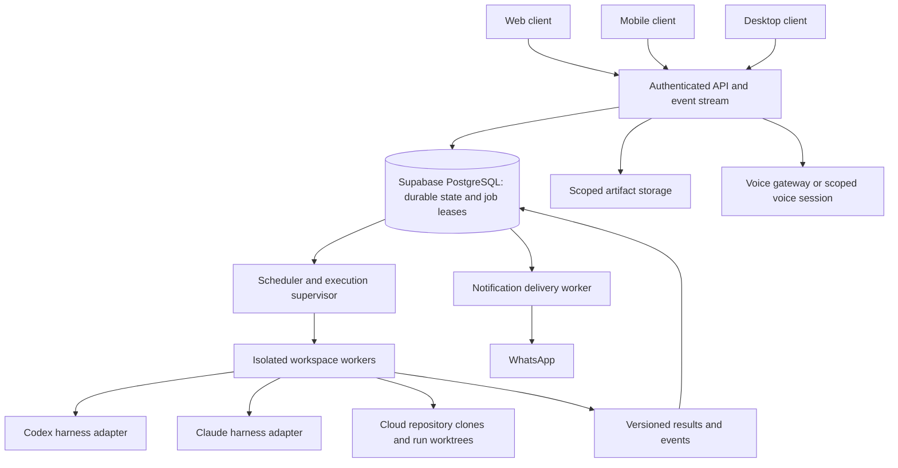

# Jarvis harness: local-first rewrite and cloud migration plan

Phase one is approved for ticket-by-ticket implementation. The [GitHub review checklist](https://github.com/ivangergo3/jarvis/issues/139) links the 32 accepted scopes and tracks the owner’s later hands-on verification.
Initial planning and research: 17 November 2026. Ticket scopes approved: 21 November 2026.
Baseline: current Swift application and existing engineering guardrails on `main`.

## 1. Outcome and boundaries

Start by replacing the usable Swift desktop app with a behaviorally and visually equivalent React/Electron app, a local NestJS backend and Codex CLI integration. Then introduce the web app and move the backend/execution to the cloud; add the iPhone app next. Claude Code, additional platforms and historical-chat import follow later. Jarvis coordinates work through supported agent harnesses rather than rebuilding their reasoning/tool loops.

The first version serves **one owner**, not a customer-facing multi-tenant service. Preserve the possibility of adding users later without paying the complexity cost now. Cloud execution is a later phase requirement, not a prerequisite for the desktop rewrite. A local service or a cloud VM alone is not a sandbox boundary.

This document proposes architecture, acceptance criteria, documentation migration and a ticket sequence. It does not install dependencies, provision infrastructure, connect accounts, migrate conversations, remove documentation, change skills or disable existing checks. Proposed choices below become requirements only after the relevant planning decision is accepted.

### Confirmed owner direction

| ID | Requirement / decision |
| --- | --- |
| R01 | Three interfaces: web, desktop app and mobile app. Prefer one stack and share components where practical. |
| R02 | One monorepo, including backend and shared types/contracts. |
| R03 | Phase one runs the NestJS backend and Codex locally against explicitly selected local repositories. Introduce web/cloud execution and cloud repository clones in phase two. |
| R04 | Commands run through the backend/provider boundary with enforced permissions, never through a general renderer shell bridge. No embedded client terminal is required initially. |
| R05 | Use Codex CLI first, independently of the Codex desktop UI. Add Claude Code later through its supported harness integration surface. |
| R06 | System-managed skills, manual/event/scheduled triggers and automated guardrails. |
| R07 | Two-way voice is required. WhatsApp is the first external communication/notification channel. Reassess its role once mobile app notifications are available. |
| R08 | Existing automated independent review, local tests and CI remain. The owner does not need to read code or approve each merge. |
| R09 | Agree a detailed plan and tickets first. Agents implement exactly those tickets; successful in-scope changes may be merged without another owner merge approval. |
| R10 | Keep small, coherent PRs: each rewrite PR stays below 1,000 added plus deleted text lines, with a warning at 800. |
| R11 | Audit documentation and extend reusable skill support to TypeScript before relying on the new workflow. Preserve useful evidence. |
| R12 | Plan before rewriting. Preserve the current usable application during the transition. |
| R13 | Write the new backend in strict TypeScript and run it on Node.js. Bun is excluded from the selected stack. |
| R14 | Use NestJS for the backend application structure, to give agent-written changes consistent module and dependency conventions. |
| R15 | Use pnpm workspaces for dependency/package management and Turborepo for monorepo task coordination. |
| R16 | Start with the supported local Docker-based Supabase stack: PostgreSQL for data and Supabase Auth for Jarvis login. Hosted deployment is later; Storage remains available for future adoption. |
| R17 | Use shared Zod schemas as the canonical API/event validation contracts, with inferred TypeScript types across clients and backend. |
| R18 | Use React DOM for the shared responsive UI, Electron for desktop and Capacitor for mobile. The phone should feel like a compact Jarvis control room. |
| R19 | Delivery order: existing Swift app -> equivalent local Electron/NestJS/Codex app -> web and cloud backend -> mobile -> later expansion. macOS and iPhone first; Linux, Windows and Android later. |
| R20 | Preserve exact current UI appearance and behavior as the rewrite baseline. Inventory/test it before replacement; record integration exceptions explicitly rather than redesigning during the port. |
| R21 | Initially show new Jarvis-managed CLI conversations. Importing existing Codex desktop history is deferred to a later ticket. |
| R22 | Sign Codex CLI in with the owner's ChatGPT subscription. Do not configure API-key billing or copy temporary access tokens into Jarvis configuration for phase one. |
| R23 | Closing the window and Command-Q both confirm before stopping the local service and its active tasks; canceling confirmation leaves work running. This supersedes the earlier keep-running-on-close decision. Start the service when Jarvis opens, not at login. Restore durable state after crashes, reconcile uncertain effects and never blindly replay commands. |
| R24 | Use Vite for the shared React UI and TanStack Router for navigation. Select compatible Electron build/packaging integration during technical design. |
| R25 | Use TanStack Query for backend state and built-in React state/focused contexts for UI state. No Redux, RTK Query, Zustand or competing external state store. |
| R26 | Adopt Google's TypeScript style guide as the code-style baseline, enforced through applicable ESLint/compiler/format checks and explicit framework exceptions. Preserve existing Jarvis visuals separately. |
| R27 | Use Vitest, React Testing Library and Playwright. Prefer Mobilewright for Capacitor/device testing, subject to a later qualification ticket. |
| R28 | Initial new voice flow is push-to-talk; no continued voice session with the phone locked. Preserve a future live-conversation option and create a decision ticket before implementation. |
| R29 | WhatsApp scope includes replies/commands and creating new tasks, as well as notifications. Sender identity and command authorization must be designed before connecting it. |
| R30 | Each run binds to its selected repository/destination. Retain Codex sandbox/approval enforcement, show required permission requests and do not grant broader authority implicitly. Broader unattended powers are deferred. |
| R31 | Jarvis is the owner's main coordinating chat above subagents. The owner gives work to Jarvis; Jarvis delegates bounded tasks, gathers results and reports back. Subagent chats remain inspectable for double-checking, without requiring the owner to manage them individually. Implementation timing is a separate decision from initial desktop parity. |

**Clarification:** “no review needed” means no mandatory *owner code review*. It does not remove independent agent review, automated verification, permission enforcement or issue acceptance criteria. The owner's follow-up explicitly retains those guardrails.

During coexistence, follow the [push guardrails](push-guardrails.md) and the owner's explicit grants for the approved tickets. Passing checks alone grants no merge authority. A future standing merge policy must specify eligible tickets, required evidence and owner acceptance points. Deployment, purchases, external communications and changes to guardrails each require their own authority.

## 2. Settled decisions, deferred decisions and remaining specifications

These are planning dependencies, not reasons to stop drafting. No unanswered item counts as consent.

| ID | Decision | Status / remaining work | Must settle before |
| --- | --- | --- | --- |
| D01 | Platforms | Settled: macOS then iPhone; Linux/Windows/Android later | Per-phase packaging qualification |
| D02 | Frontend tooling | Settled: Vite, TanStack Router, TanStack Query + React state. Specify Electron packaging, dependency versions and narrow platform adapters | Foundation tickets |
| D03 | Provider/authentication | Settled locally: Codex CLI + subscription sign-in. Specify interactive protocol, event mapping and credential boundary; Claude/cloud authentication later | Local provider integration |
| D04 | Voice | Push-to-talk, no locked-phone session; future live option. Defer implementation/provider/cost details to an explicit decision ticket | New voice implementation |
| D05 | WhatsApp | Replies, commands and new tasks accepted; defer sender binding, webhooks, replay protection, account setup/templates/costs | Live channel integration |
| D06 | Cloud provider/region/budget | Explicitly deferred until web/cloud migration; compare providers using measured workloads and operating requirements then | Cloud provisioning |
| D07 | Jarvis authentication/access | Supabase Auth accepted, local stack first. Specify local service authentication and later remote session/TLS exposure | Local service, then remote deployment |
| D08 | Existing history | New sessions first. Historical import/export gets a later ticket; no initial desktop-history synchronization | History migration |
| D09 | Action permissions | Initial boundaries accepted; exact profile/repository grants in phase-one tickets. Broader unattended deployment/spending/sending deferred | Relevant privileged effects |
| D10 | Data/recovery | Local Supabase persistence first; specify volumes, migrations, reset protection and backup/recovery. Cloud retention/recovery later | Real local data, then cloud migration |
| D11 | Concurrency/resources | Specify local scheduling, process cleanup and measured budgets; size cloud workers later | Local execution acceptance |
| D12 | Distribution/licensing | Personal macOS build first; signing/update behavior to specify. Other OS/app-store distribution later | Respective distribution |
| D13 | First-release scope | Settled: current Swift UI/behavior parity, new CLI sessions and local backend. Produce feature inventory and explicit integration mappings; new orchestration features later | Implementation ticket breakdown |

The Swift inventory and verification map accompany this plan. [The local design ticket](https://github.com/ivangergo3/jarvis/issues/108) resolves the remaining phase-one contract and lifecycle details. Cloud, mobile and external channels remain later decisions.

## 3. Recommended shape

Use a **TypeScript modular monolith with supervised provider processes**, not many independently deployed services. Start locally and keep execution outside the renderer. Share contracts, pure logic, feature state and UI components. Separate the local service lifetime from the window lifetime; cloud worker isolation is qualified later.

Phase-one topology: Electron renderer -> authenticated local NestJS service -> supervised Codex CLI, with a local Docker-based Supabase stack. The renderer uses the same typed API boundary intended for remote access later. Commands and credentials stay behind that boundary. Specify the loopback endpoint's access checks; loopback alone is not authentication.

The following diagram is the **later target**, not a requirement to build all surfaces, providers and workers in phase one:



The supervisor mediates approved capabilities. Worker results are untrusted inputs to the control plane. A worker never obtains the control-plane database credential just because it needs to report progress.

### Agreed stack and remaining integration choices

| Layer | Selection / status | Why / condition |
| --- | --- | --- |
| Language | **Agreed: TypeScript with strict checks** | Shared contracts and tooling across product layers; native platform configuration may still be necessary. |
| Backend runtime | **Agreed: Node.js; no Bun** | Runtime is distinct from the TypeScript source language. Pin a supported version during foundation planning. |
| Backend framework | **Agreed: NestJS** | Modules, controllers, services and dependency injection give agent-written changes consistent structure. HTTP adapter remains an implementation decision. |
| API/event schemas | **Agreed: Zod** | Shared runtime validation with inferred TypeScript types; server authorization remains separate. |
| Package management | **Agreed: pnpm workspaces** | Install dependencies and link internal packages in one workspace. |
| Task coordination | **Agreed: Turborepo** | Dependency-aware task ordering, parallelism and eligible output caching. Keep caching separate from required fresh acceptance evidence. |
| Durable data | **Agreed: Supabase PostgreSQL** | Tasks, runs, events, leases, policies, triggers and notification outbox. |
| External channel | **Agreed: WhatsApp first** | Implement supported delivery; reassess alongside future mobile push notifications. |
| Web/shared UI | **Agreed: React DOM** | Share responsive components, rich-message rendering and Jarvis visuals across all clients. |
| Desktop | **Agreed: Electron with bundled web renderer** | Host the shared web UI with a narrow TypeScript platform bridge; qualify packaged resource use and behavior. |
| Mobile | **Agreed: Capacitor** | Host the shared React DOM UI in a mobile WebView; use platform adapters/plugins where needed. |
| Frontend build | **Agreed: Vite** | Electron main/preload integration and packaging remain bounded design choices. |
| Navigation | **Agreed: TanStack Router** | Typed project/task destinations; qualify desktop navigation first, web/mobile deep links in their phases. |
| Frontend state | **Agreed: TanStack Query + React state/context** | Query owns backend cache; React owns transient interface state. No Redux or additional state library. |
| Jarvis login | **Agreed: Supabase Auth** | Local stack first; provider credentials remain a separate boundary. |
| Data deployment | **Agreed: local Docker-based Supabase first** | Persistent volumes/migrations; hosted infrastructure selection is deferred. |
| Code style | **Agreed: Google TypeScript style baseline** | ESLint/type-aware rules, compiler checks and formatting; document rules requiring review/framework exceptions. |
| Tests | **Agreed: Vitest, React Testing Library, Playwright** | Qualify Nest transforms/metadata and Electron automation; Mobilewright is the preferred later mobile candidate. |
| Artifacts | Storage integration scope pending | Supabase Storage available later; keep images/logs/reports out of hot event rows. |

NestJS is selected for application conventions, not as a substitute for permissions, sandboxing or tests. Keep domain rules and provider/execution implementations independent of controllers and framework decorators. Nest can use Fastify as its HTTP adapter, but selecting Nest does not also select that adapter. [Nest modules](https://docs.nestjs.com/modules), [HTTP adapters](https://docs.nestjs.com/techniques/performance).

Use Zod-based validation at transport boundaries, including a Nest validation pipe where appropriate. Do not duplicate shared schemas as independently maintained validation classes. [Nest schema-validation pipes](https://docs.nestjs.com/pipes), [Zod](https://zod.dev/).

Share React DOM components and feature logic, while adapting layouts for touch, smaller screens, keyboard behavior and accessibility. Capacitor provides a native bridge for supported plugins; native capabilities are not automatically identical to the web implementation. Keep dependency versions compatible across entry points. [Capacitor overview](https://capacitorjs.com/docs), [native plugins](https://capacitorjs.com/docs/basics/using-plugins).

pnpm manages dependency installation/workspace links; Turborepo coordinates package tasks and caches eligible outputs. Neither replaces explicit package boundaries. Vite is the selected frontend development/build tool, not a replacement for Turborepo. [pnpm workspaces](https://pnpm.io/workspaces), [Turborepo internal packages](https://turborepo.dev/docs/core-concepts/internal-packages), [Vite integration](https://turborepo.dev/docs/guides/frameworks/vite).

Configure Turborepo task inputs, environment and outputs explicitly. Required fresh acceptance runs, sandbox exercises and live integrations must not be satisfied by cached passing results. No remote cache service/account is implied by adopting Turborepo. [Task caching](https://turborepo.dev/docs/crafting-your-repository/caching).

Use the supported Supabase CLI/container-runtime workflow for a local stack, rather than treating Supabase as one database image. Include local Auth and database persistence; specify volume ownership, migrations, backups and protection against accidental resets. Agent execution remains in the local service/provider process initially and later on cloud workers, not in Edge Functions. Storage adoption is a later slice. [Local development](https://supabase.com/docs/guides/local-development), [Supabase database](https://supabase.com/docs/guides/database/overview), [Edge Function limits](https://supabase.com/docs/guides/functions/limits).

Alternatives considered were Expo/React Native for shared web/mobile or a separate native mobile UI, and Tauri for desktop. React DOM/Electron/Capacitor was selected for the owner's custom control-room experience and UI reuse. These alternatives are not parallel implementation targets. Keep the existing Swift client available during migration; revisit the selected stack only through an explicit decision if qualification finds a blocking issue.

Test Electron as a packaged build. Its renderer must have a narrow validated bridge, isolation and sandboxing; remote content must not gain general Node or shell access. [Electron security](https://www.electronjs.org/docs/latest/tutorial/security/).

### Required client-stack and integration qualification

First qualify packaged macOS Electron against the existing Swift app: project selector, graph/list, long conversation, table/code/image messages, composer, settings, approvals, audio controls and task state. Verify keyboard behavior, paste/upload, accessibility, layout, local service reconnect and performance. Use synthetic data for public evidence. Add browser and Capacitor/device qualification only in their phases; they do not gate the initial desktop port.

Measure idle/active CPU, memory, graph/card hover, event bursts, long history scrolling, background battery behavior and animation suspension. Use release/packaged builds and record OS/device/toolchain. The old hover regression is an explicit negative fixture. Adapt graph detail and layout to the phone without shrinking the whole desktop view. Blocking performance or native-integration gaps return to planning rather than silently switching frameworks.

## 4. Monorepo and dependency rules

Illustrative destination; create packages only when a slice needs them:

```text
apps/
  client/                 React DOM web entry and shared responsive app composition
  desktop/                Electron main/preload and bundled web entry
  mobile/                 Capacitor native projects, configuration and mobile entry
  server/                 NestJS composition, modules and authenticated transport
  worker/                 Supervisor/worker entry points
packages/
  contracts/              Shared Zod wire schemas, inferred types, IDs and events
  domain/                 Pure task/run/policy rules
  api-client/             Typed commands, events, reconnect and dedupe
  ui/                     Jarvis tokens and shared React DOM components
  features/               Shared client workflows and view models
  platform/               Narrow audio, storage, notification/deep-link contracts
  providers/              Server-only harness adapters
  execution/              Server-only sandbox/process/workspace management
  persistence/            Server-only Supabase/PostgreSQL repositories and migrations
  skills/                 Server-only skill catalog/materialization logic
  quality/                TypeScript quality tooling and evidence contracts
skills/                   Canonical reusable skill text and references
docs/engineering/         Accepted decisions, specifications and evidence
```

Rules to enforce with package exports, compiler projects and import checks:

1. Clients depend on contracts/domain/client/UI packages, never persistence, providers or execution.
2. Contracts and pure domain never import apps, UI, database clients or process libraries.
3. Shared schemas contain transport-safe data, not server implementations or secrets.
4. Platform effects sit behind narrow adapters. No privileged shell bridge in the desktop renderer.
5. API and worker entry points construct capabilities; ordinary modules receive interfaces.
6. Skill text is content, not automatically executable imports or permission grants.
7. Cycles, cross-package private imports and server packages in client bundles fail checks.

Use Zod as the canonical API/event schema source and infer the shared TypeScript types. Validate inputs on the server even if clients already validated them. Any OpenAPI/JSON Schema conversion must be derived and tested, not a second handwritten contract. Specify dates, large numeric identifiers, optional/null fields, enum evolution and unknown event handling. Database constraints and migrations remain separate responsibilities; shared API schemas do not replace them.

### Frontend state ownership

Use one external backend-state solution: TanStack Query. Cache keys include stable project/conversation/run IDs; stream events update or invalidate that cache with ordering/deduplication rules. Do not mirror the same server records in a parallel React context store. Query mutations call the typed API; reconnection never blindly replays an uncertain command.

Use ordinary React state and small focused contexts for drafts, panel visibility, selection and layout. Destinations are captured on send; switching projects cannot reroute an existing draft. Keep subscriptions/updates narrow so pointer movement or one run event does not rebuild the entire graph. No Redux, RTK Query or Zustand. The backend uses Nest services and durable state; it does not need a frontend store library.

Preserve existing Swift source and its quality entry points during coexistence. Decide its eventual location in a separate migration ticket; do not move everything merely to match this sketch.

## 5. State ownership and contracts

The backend is authoritative for projects, task status, execution and histories, whether running locally or remotely. Clients own transient presentation, drafts and audio controls. A disconnect alone does not prove work stopped. A confirmed local window-close/Quit initiates shutdown; task termination must be verified before reporting it. Later remote-client closure semantics need a separate phase-two decision.

Initial entities: Owner, Workspace, Project, Repository, Task, Run, Attempt, ProviderSession, RunEvent, SkillVersion, Trigger, PolicyVersion, ActionRequest, Artifact, VerificationResult and DeliveryAttempt. Use stable IDs; display names are never routing keys.

### Jarvis as the main coordinating chat

The primary interaction is Owner -> Jarvis -> subagents -> Jarvis -> Owner. Jarvis receives the requested outcome, clarifies when necessary, delegates bounded work and consolidates progress, blockers and evidence into its replies. It is an actual coordinating agent, not merely a graph label or a dashboard summarizer.

Subagent conversations remain accessible from their tasks/nodes for inspection and double-checking. Routine use must not require the owner to copy messages between chats, assign each worker manually or collect their results. Opening a worker chat for inspection must not itself submit a message or change who owns its task. The UI should make the main Jarvis conversation distinct from inspected worker conversations.

Persist coordinator/task/delegation relationships and relevant decisions/results so the Jarvis identity survives app restarts and provider-session/context replacement. Do not depend on one infinitely growing transcript or imply that a running subagent is durable memory. Use stable IDs to retain task/chat provenance and explicit repository destinations.

Delegation inherits the accepted task scope, permissions, review/tests and resource limits. Jarvis cannot grant itself or workers broader authority, bypass an approval or declare completion from a summary without task evidence. Specify task ownership, cancellation propagation, failures and recovery before implementation.

R31 is an accepted product requirement, not authorization to build coordination now or expand the initial Swift-parity port. Keep the current graph and worker-chat inspection compatible with that direction; agree the coordinator delivery slice separately, without automatically scheduling it before or after cloud/mobile work.

Proposed run lifecycle:

```text
queued -> starting -> running -> succeeded | failed
                         |-> waiting_input -> running
                         |-> waiting_permission -> running
                         |-> cancelling -> cancelled
crash/lost ownership -> interrupted or unknown -> reconciliation
```

Do not flatten a provider transport error into task failure, or claim cancellation before the process/effect has stopped. Specify allowed transitions, terminal state rules and the owner of each transition before implementation.

### Initial API and event behavior

- Typed commands/queries plus a resumable event stream; REST + SSE is the initial proposal. Specify an authenticated loopback transport locally and TLS for remote access later. Evaluate WebSocket where bidirectional streaming actually requires it.
- Starting work records the accepted task/criteria versions, selected project/repository, provider, skill snapshot, policy and idempotency key durably before scheduling.
- Job leasing has expiry, heartbeats and fencing so a stale worker cannot overwrite the new owner's run. Concurrency is limited per repository and overall.
- Each durable event has a run ID, event ID, sequence, schema version and timestamp. Clients resume by cursor and deduplicate; snapshots recover expired cursors.
- State change and notification/job outbox writes are transactional. Delivery may repeat; logical effects must be idempotent where possible.
- A lost response is uncertain delivery, not permission to create a second run. Reconcile by key/remote state before retrying.
- Server errors are typed: retryable, permission denied, validation, unavailable capability, conflict, unknown outcome. Private paths/tokens are redacted.
- Version negotiation supports rolling client updates. An outdated client must fail clearly for unsupported commands rather than misinterpreting them.

### Multi-device behavior

One run can be observed from all clients. The server arbitrates conflicting commands; more than one UI cannot own the same active provider turn. A draft retains its destination when switching projects/chats. Sending captures that destination explicitly, and optimistic messages reconcile to server IDs.

For phase-one parity, reopening a conversation scrolls to the latest message. Swift also scrolls to the bottom when the last message changes, including while reading older messages. Preserving a deliberate reading position during incoming updates is a possible later change. Offline clients may retain safe drafts and last-known state; starting privileged work requires an authenticated server acknowledgement. Never replay stale offline commands silently.

Phase one shows new Jarvis-managed Codex CLI sessions, not automatic synchronization with Codex desktop conversations. Preserve the old app/history and record historical import/export as a later ticket. Do not use desktop database scraping as the replacement control protocol.

## 6. Provider harness integration

Keep Jarvis as orchestration around provider harnesses first. Do not implement a second model tool loop, context compactor or undocumented terminal scraper unless a later requirement justifies it.

Codex CLI is the phase-one engine, independently of the desktop UI. Assess its supported app-server integration for interactive sessions, events, interruption and approvals; SDK/exec can suit bounded jobs. Calling the CLI's structured app-server protocol is compatible with this CLI-first requirement; automating the desktop UI or scraping terminal text is not. Verify the installed protocol and pin the chosen integration. [Codex integration guidance](https://developers.openai.com/blog/codex-as-a-platform), [app-server documentation](https://developers.openai.com/codex/app-server/).

Use supported ChatGPT account sign-in for subscription access. No API key or manually copied short-lived access token is selected for phase one; no automatic fallback to API billing. Validate the selected authentication mode without logging credentials. Let Codex manage its credential lifecycle, with a controlled backend access boundary. Supabase authenticates the owner to Jarvis, not Jarvis to Codex. [Codex authentication](https://learn.chatgpt.com/docs/auth).

For the later Claude phase, assess the TypeScript **Agent SDK** or structured CLI integration, not just the generic Messages API client. The SDK runs a stateful CLI process; its local session files, process lifetime and working directory require ownership and recovery. It is not part of initial desktop parity. [Agent SDK overview](https://code.claude.com/docs/en/agent-sdk/overview), [hosting guidance](https://code.claude.com/docs/en/agent-sdk/hosting).

Specify an adapter capability matrix before promising parity: start/resume, messages, events, cancellation, tools, approvals, skills, attachments, usage reporting and session export. Unsupported/unknown must be visible. Provider session IDs map to Jarvis runs; do not silently change provider mid-turn.

Pin and record CLI/SDK/protocol versions. Capture synthetic fixtures for adapter compatibility; upgrading a provider reruns those contracts. User-selected skills/hooks must not replace the host's permission enforcement.

Cloud authentication is a separate decision: validate supported headless sign-in, credential refresh/storage, account terms and billing for the chosen integration. Do not assume a local subscription automatically covers cloud automation or voice, and do not assume it necessarily cannot. Document the verified account mode before connecting it.

## 7. Local execution, lifecycle and later cloud sandbox

### Phase-one boundaries and lifecycle

Each project explicitly selects its repository; each run records that destination and its working directory before dispatch. Retain Codex's supported sandbox and approval enforcement. Required permission requests appear in Jarvis and cannot be silently approved by it. Do not expose a general shell API to React, grant access outside the selected workspace implicitly, or pass the backend's complete credential environment to tools. A repository path is not itself a sandbox.

The owner's latest decision supersedes keep-running-on-close: both window close and Command-Q ask for confirmation before stopping the local service and its active tasks. Canceling confirmation preserves the window/service/work. Confirming first stops new dispatch, then requests cancellation and verifies owned process cleanup, persists outcomes and closes the app. Do not report success or rollback for an uncertain external effect. No blanket permission to stop another app's Codex processes or all Docker containers is implied.

Initially start the service only when Jarvis opens, not automatically at login. Relaunch must avoid duplicate service/provider owners. After a crash or reboot, restore durable state and reconcile receipts/process ownership before resuming; do not blindly replay uncertain commands. Machine sleep promises no progress. Exact shutdown timeout/escalation, drafts and handling of unfinished cleanup need the local design specification. See the [verification and lifecycle matrix](rewrite-verification.md).

Select the lifecycle mechanism in a bounded design ticket: for example a separately supervised service or a background Electron/service owner. This plan does not install a login item/daemon. Persist state in local Supabase; do not make process survival depend on the renderer retaining a reference.

### Later cloud boundary

Cloud provider, region, budget and host sizing are explicitly deferred until phase two. A single Linux VM is a candidate, not an accepted purchase or deployment. Separate trusted control plane and execution using appropriate OS/container or stronger isolation; qualify that boundary independently of the local implementation.

Each worker receives only its assigned repository/worktree, immutable inputs and approved capabilities. Use non-root execution, bounded CPU/RAM/processes/disk/time, controlled mounts, bounded output and explicit network/secret access. Never expose the host Docker socket or mount owner credentials/home directories into the agent environment.

Worktrees prevent ordinary branch collisions; they are **not a security boundary**. Repository builds and dependencies may execute untrusted code. Decide whether container isolation is sufficient for this personal workload or stronger VM/microVM separation is needed. Test denied filesystem, process and network access from inside the worker.

The API must not run an unrestricted agent inside its own credentialed process. Separate worker reporting credentials from database/admin credentials. Broad model-provider credentials should be brokered or scoped; if a credential must enter a worker, document the capability and exposure.

Clone only approved repositories with scoped Git credentials. Fetch/checkout verification binds a run to an explicit base and ticket. Use a workspace per active branch and serialize incompatible operations. Preserve uncommitted changes during cleanup, and apply retention to abandoned workspaces.

Stop/cancel owns the complete process tree and descendants, including build tools. A timeout is not success. Lease loss prevents new effects and triggers reconciliation. Host reboot recovery identifies orphaned/interrupted work before scheduling duplicates.

### Git, tickets and delivery

Accepted ticket -> branch/workspace -> implementation -> independent review -> full applicable local checks -> push -> required CI -> merge. No owner code-reading step is required for agreed tickets whose gates pass.

Each ticket states acceptance criteria, permitted files/boundaries, exclusions, dependencies, risk and evidence. Scope discovery may produce a new ticket; it does not authorize implementing that new work immediately. Apply the 800-line warning and 1,000-line stop to the full text diff, including tests/docs. Split by a useful verified outcome, not arbitrary file fragments.

Merges must recheck current head/base, required statuses and conflicts. A changed base invalidates affected evidence under the existing guardrail policy. The agent cannot bypass reviews/hooks because it is unattended. Tickets and policy versions are recorded with merge evidence.

Deployment is a separate workflow with environment-specific grants, rollback and migration checks. “Merged” is never displayed as “deployed” without deployment evidence.

## 8. Skills and triggers

Preserve currently supported behavior during desktop parity. The expanded server-managed catalog, new triggers and coordination capabilities below are later product slices unless they are required to preserve an inventoried existing feature.

Keep canonical reusable skill text under `skills/`, with system-managed metadata and immutable versions. Initial proposal: Git-reviewed content plus a database catalog/index. An editing UI, if later needed, creates a candidate version rather than silently replacing active instructions.

Lifecycle: draft -> validated -> published -> selected -> materialized into worker -> used by run -> retired. Every run records content hashes/versions and selection reasons. An update affects future runs, not an active run's instructions midway through execution.

Provider-specific discovery files are adapters over the canonical skill set. Verify actual discovery in each supported CLI, rather than assuming identical paths/behavior. Distinguish reusable instructions, project policy, owner preferences and tool capabilities.

Skills, retrieved pages and repository instructions are untrusted content at the authority boundary. They cannot grant credentials, change policies or approve their own actions. Scan imported content and evaluate it with isolated synthetic scenarios before publication.

### Trigger contract

Manual, schedule and authenticated event triggers all create ordinary bounded tasks. A trigger specifies owner/project, event filter or schedule, skill/task template version, permitted action class, budget, concurrency and expiry/disable behavior.

Use UTC storage plus an explicit IANA schedule timezone. Define daylight-saving, missed-run and overlapping-run policy. Webhooks require source authentication, replay protection and deduplication. Event chains have maximum depth, rate and cumulative spend so an agent-generated event cannot create an unbounded self-trigger loop.

Disabling a trigger stops future dispatch and defines what happens to queued jobs; it must not silently terminate already authorized external effects. Triggered tasks use the same checks as manually started tasks. Periodic audits supplement execution-time checks, never replace them.

## 9. Voice and notifications

Preserve existing desktop audio controls/behavior in the parity inventory. Before implementing the new two-way voice flow, create a decision ticket for provider, transport, cost and acceptance. The agreed initial direction is push-to-talk while the phone is unlocked/in use; no continuing locked-phone voice session. Keep live interruptible conversation as a future option, not an initial requirement. Voice routes to the selected conversation through the same task/message permissions as typing.

Propose an explicit microphone control, visible recording state, transcript preview/correction, mute/stop and a clear active destination. The server remains responsible for task execution. Speech/transcription content cannot bypass permissions. A spoken cancellation must report server confirmation, not only stop audio playback.

For the deferred voice decision, compare:

- Transcription -> ordinary text command -> speech synthesis: simpler continuity with existing messages, but turn latency may be higher.
- Realtime audio session linked to server tools: potentially more conversational; validate mobile transport, interruption, scope, reconnect and metering independently.

Choose and qualify browser/Electron audio and Capacitor native/plugin audio as platform adapters. Do not assume a working desktop microphone proves iPhone Bluetooth, interruption or locked-screen behavior. Capacitor can bridge native capabilities, but the actual voice transport and plugin remain to be selected. [Capacitor plugins](https://capacitorjs.com/docs/basics/using-plugins). OpenAI documents WebRTC and short-lived client credentials for realtime clients; permanent provider credentials still belong on the server. This is one candidate, not a voice-provider selection. [Realtime WebRTC](https://developers.openai.com/api/docs/guides/voice-webrtc).

Define retention separately for audio and transcripts; propose no persistent raw audio by default. Test permission denial, Bluetooth changes, interruptions, lock-time stop and reconnect. Background listening/wake words are outside the initial scope. Measure voice cost separately from subscription-backed CLI usage; subscription CLI authentication does not establish voice billing coverage.

### Notifications

WhatsApp is the accepted first external channel. Plan the supported Business Platform integration, including account/onboarding requirements, templates, delivery behavior and operating cost. Proactive notifications outside a customer-service window require template messages. Telegram is not part of the initial scope. [WhatsApp platform overview](https://developers.facebook.com/documentation/business-messaging/whatsapp/overview/), [template rules](https://developers.facebook.com/documentation/business-messaging/whatsapp/templates/overview/).

Once mobile push notifications are available, reassess whether WhatsApp should remain, supplement push or be retired. Keep the delivery adapter separate so that decision does not require changing task execution.

Initial notifications: task completed, failed, waiting for input or a required permission. Send short summaries and authenticated deep links, avoiding private conversation contents by default. Channel tokens stay server-side; recipients are explicitly allowlisted.

Use a durable outbox with delivery status, dedupe key, bounded retries and rate limits. Provider acceptance is not proof the owner read a message. A notification failure does not change task success.

WhatsApp replies/commands and creating tasks are accepted later-channel scope. Design owner/sender binding, webhook authentication, replay protection, command deduplication and destination routing before connecting it. A valid webhook alone does not prove the sender is the owner. Commands enter the ordinary task/permission pipeline; messaging does not grant extra powers. Privileged approval by WhatsApp is not implied by permission to create tasks and needs an explicit decision. Defer this integration design until its phase rather than blocking the desktop rewrite.

## 10. Verification, security and operations

Retain independent minimal-context review and full applicable checks before every push. Migrate the implementation of those checks deliberately; do not call a TypeScript build “fully checked” while it bypasses the Swift-era guardrail intent.

Proposed checks:

| Boundary | Evidence required |
| --- | --- |
| Source quality | Strict TypeScript, correctness lint, deterministic formatting, package/import boundaries and no accidental server code in clients. |
| Domain/contracts | State transitions, schema compatibility, invalid inputs, routing IDs and error mapping. |
| Persistence | Real isolated PostgreSQL migrations/transactions, leases, fencing, dedupe and outbox recovery. |
| Providers | Synthetic sessions/events, permission requests, malformed streams, cancellation and version incompatibility. |
| Isolation | Denied mounts/network/secrets, resource limits, child-process cleanup and lost-worker recovery. |
| Web UI | Real browser task flow, rich content, attachments, keyboard behavior and reconnect. |
| Desktop | Packaged app launch, renderer/IPC restrictions, links, paste, updates and resource measurements. |
| Mobile | Simulator/device task flow, layouts, audio permissions, network transitions and notification deep links. |
| Delivery | Independent review, exact candidate/base evidence, required CI, size cap and merge reconciliation. |
| Recovery | Restore from backup, host reboot mid-run and failed deployment rollback. |

Agreed tools: Vitest for TS unit/integration tests, React Testing Library for DOM behavior and Playwright for browser/Electron workflows. Qualify Nest's compilation/decorator metadata and the supported Electron automation path before relying on the gate; do not silently substitute Jest or mark unsupported checks passed. Mobilewright is the preferred later mobile candidate: qualify Capacitor WebView/device interaction, reports, CI and failure behavior in its own ticket. It is not a required phase-one installation. [Mobilewright WebViews](https://mobilewright.dev/docs/guides/webviews).

### Code style and visual parity

Use Google's TypeScript guide as the baseline with strict compiler checks, type-aware ESLint, React Hooks rules, deterministic formatting and package/import checks. Map enforceable rules to configuration, document explicit React/Nest/tooling exceptions and retain review for semantic guidance that cannot be mechanically checked. Do not claim ESLint enforces the entire prose guide. Evaluate Google's `gts` configuration as a starting point, not automatic proof of full coverage. [Google guide](https://google.github.io/styleguide/tsguide.html), [gts](https://github.com/google/gts), [typed linting](https://typescript-eslint.io/getting-started/typed-linting/).

Google code style does not define the product's appearance. Preserve the current Swift Jarvis theme, layout and interactions through shared visual tokens/components and representative screenshot/behavior comparisons. Do not introduce a redesign or require the owner to select another visual style before starting the port.

Normal CI uses fake providers, synthetic repositories and isolated test data. Real agent/voice/messaging exercises are separate, explicitly configured and budget-capped. Never leak real conversations in screenshots, logs or public evidence.

Test negative behavior: zero tests collected, skipped required checks, weakened policy, forged/stale receipts, duplicate commands, reordered events, duplicate webhooks, partial sends, lease expiry, credential revocation, full disk, provider outage and shutdown during work. Preserve failures rather than retrying until a green sample hides them.

### Performance and observability

Carry forward the graph/card hover regression and synthetic scale fixtures. Measure 20/100-chat graphs, long histories, concurrent event updates, idle/background behavior and sustained pointer movement. State updates should affect the relevant component/run, not rebuild the whole workspace on hover. Animation must suspend when not visible.

The Swift CPU warnings are specific to the measured native app. Measure Electron on the owner’s Mac and agree its numerical warning budgets. If an existing required gate cannot be met or equivalent coverage demonstrated, stop the performance ticket and dependent cutover for the owner’s explicit decision. [Performance qualification](https://github.com/ivangergo3/jarvis/issues/136)

Correlate task/run/attempt/request IDs across logs, metrics and traces. Record queue delay, provider lifecycle, tool denials, failures, reconnects, notification delivery, resource use and available usage/cost evidence. Show unknown/unavailable usage rather than guessing precise token charges. Redact secrets and bound log retention/output.

### Availability, data and cost

Use authenticated TLS access and revocable owner sessions; decide browser cookie/CSRF and native token storage separately. Rate-limit commands and uploads. Artifacts need path/content/size validation and scoped reads; a filename must never authorize arbitrary server file access.

Separate application secrets, provider access and Git credentials. Use backup encryption, migration backups and a tested restore procedure. Agree recovery point/time objectives rather than inventing them. A single host failure must be visible; high availability can remain a later requirement.

Set resource/spend caps for infrastructure, model calls, voice, storage and notification delivery. Bound worker concurrency and trigger fan-out. Define stop behavior on a limit, including in-flight work and cleanup. An estimated cost is labeled as such; test jobs cannot spend unbounded money.

## 11. Extend the reusable skills for TypeScript

This section plans skill work; it does not edit or replace skills. Keep generic entry points and technology-specific references, rather than cloning every skill into separate Swift/TypeScript versions. Preserve Swift guidance while the native app remains supported.

| Skill / group | Planned change | Evaluation |
| --- | --- | --- |
| `software-implementation` | Add TS reference selection alongside the existing Swift verification reference; cover package boundaries, async ownership, runtime validation and server/client separation. | Synthetic frontend, backend and shared-contract tasks; reject secrets/process code in client/shared. |
| `technical-design` | Retain generic boundaries; add examples for remote run ownership, multi-device state and sandbox isolation if needed. | Design with reconnect/cancel ambiguity and unsupported provider features. |
| `verification-planning` | Add web/desktop/mobile/server risk mapping and capability-dependent check selection. | Missing device runner or paid integration remains a gap, not a pass. |
| `test-design`, `test-automation`, `test-maintenance` | Add TS runners, DB/process fixtures, UI layers, asynchronous failure/cancellation and meaningful negative probes. | Detect zero tests, weak mocks, duplicate effects and time-dependent flakes. |
| `code-review` | Add TS/React/server examples; preserve fresh context, findings discipline and authority review. | Review only relevant candidate/base/contracts; identify a seeded regression. |
| `pull-request-preparation` | Support TS evidence/toolchain receipts and the same size/CI gates; remove per-merge owner approval only for accepted ticket scope. | Stale evidence and oversized candidate must fail. |
| Acceptance/decomposition/handoff/reporting skills | Keep technology-neutral; ensure accepted IDs, exclusions, dependencies and observed evidence remain traceable. | No invented completion, scope expansion or conflation of planned and passed tests. |
| Project skill manifest / discovery | Preserve canonical content and verify provider adapters/materialization. | Check links, hashes and actual discovery for both providers. |

Use existing evaluation references as starting points. Add isolated fixtures for new behavior, and distinguish text/frontmatter validation from behavioral success. Update project instructions and quality tooling in coherent tickets; no repo-wide skill rewrite without a demonstrated gap.

## 12. Documentation audit and transition

No document is deleted in this planning step. Classify scope, status, incoming links and successor before moving anything. Keep historical measurements immutable and distinguish them from current support requirements.

| Document at the [audited Swift revision](https://github.com/ivangergo3/jarvis/tree/d61f5915a5bf85efe4272f1317c3c8f56ed49b9d/docs/engineering) | Rewrite considerations |
| --- | --- |
| `REQUIREMENTS.md` | Retain authority during planning; create an accepted successor baseline with explicit scope/supersession before new-stack implementation. Preserve native requirements still applicable during coexistence. |
| `AGENTS.md`, `CLAUDE.md` | Retain current checks; later reconcile accepted ticket/auto-merge authority and polyglot coexistence. Keep one canonical instruction source. |
| `README.md` | Later describe current runnable versions, cloud architecture, setup and migration status truthfully. |
| `docs/planning/CAPABILITY_MAP.md` | Audit against actual planned server/client capabilities; do not present future capabilities as implemented. |
| `docs/planning/SKILL_CATALOG.md`, `SKILL_BOUNDARIES.md` | Retain generic catalog/boundaries; update only relevant language/provider support. |
| Other skill research, safety, review and evaluation notes in `docs/planning/` | Preserve provenance/evaluation evidence; index current guidance versus historical research. |
| `docs/engineering/SWIFT_QUALITY.md` | Active for Swift until retirement; new TS check specification alongside it, historical archive only after cutover. |
| `docs/engineering/agent-workflow-51.md` | Retain principles; extend execution location, durable tasks and skill-version references. |
| `docs/engineering/authority-boundaries-49.md` | Preserve trust rules; specify server enforcement, worker capabilities and remote grants. |
| `docs/engineering/traceability-54.md` | Retain accepted requirements -> tickets -> observed evidence; adapt identifiers/artifacts without a parallel backlog. |
| `docs/engineering/native-ui.md` | Active native evidence until retirement; add separate platform matrix for replacement clients. |
| `docs/engineering/command-timeouts.md` | Preserve cleanup/timeout invariants; qualify their Linux/process-tree implementation independently. |
| `docs/engineering/verification-44.md` | Keep historical evidence; never use old passing checks to certify new stack behavior. |
| `docs/engineering/test-quality.md` | Retain meaningful/negative-test principles; add TS examples where justified. |
| `docs/engineering/performance-47.md` | Preserve native budgets/regression behavior; create platform-specific replacement budgets after measurement. |
| `docs/engineering/native-boundaries-48.md` | Keep native baseline; map intent to package/process boundaries, not folder renaming alone. |
| `docs/engineering/push-guardrails.md` | Preserve independent review, exact evidence, size/local/CI checks; explicitly reconcile agreed-ticket automatic merging. |
| `docs/engineering/workspace-boundaries-46.md` | Preserve native ownership; specify remote state/transport ownership for successor. |
| `docs/engineering/performance-evidence-47-54.md` | Historical baseline, preserved with environment and failures. New evidence is recorded separately. |

Follow-up audit must also inventory linked scripts, workflow files, examples and skill references. Archive superseded guidance with a replacement link; remove only demonstrated duplicates/obsolete instructions in a separately reviewed, accepted ticket. Do not silently turn old evidence into a claim of current coverage.

## 13. Planning and implementation sequence

The sections below describe the rollout. Use the accepted GitHub issues for implementation scope, dependencies and acceptance criteria.

### P0 — finish local-rewrite planning

1. Retain R01–R31 and distinguish accepted scope from remaining design detail in D01–D13.
2. Review the [current feature/visual inventory](swift-feature-visual-inventory.md): feature -> baseline -> replacement mapping -> evidence, including historical synthetic images and remaining capture gaps. New CLI sessions/history deferral are explicit exceptions, not reasons to drop unrelated UI features.
3. Specify the local API/events, Codex CLI protocol/authentication, task/run state, approval routing, cancellation, process ownership and recovery.
4. Specify local Supabase schema/Auth/migrations, repository boundaries, initial scheduling/resource limits and packaging/lifecycle behavior, including close versus Quit.
5. Map Google-style/TS quality gates and relevant skill changes; audit documentation and propose an accepted successor requirements baseline.
6. Create/review small dependency-linked tickets with acceptance, exclusions and evidence. Keep cloud/mobile/future-feature questions in their later phases.

Exit: accepted phase-one feature inventory, contracts/lifecycle design, verification map and bounded ticket set. No implementation starts merely because the stack is selected. No need to choose a cloud provider or complete mobile design first.

### P1 — local macOS rewrite with current Swift parity

Deliver as multiple coherent PRs under the size cap:

- **Foundation:** pnpm/Turborepo, strict TypeScript, NestJS composition, shared Zod contracts, Vite/React DOM/Electron entry points and retained independent review/local/CI gates. Extend/evaluate relevant skills; preserve Swift gates during coexistence.
- **Local persistence/login:** supported Docker-based Supabase setup, migrations, durable records, Supabase Auth and protected local service access. Provide guided setup; no credential copying into React or destructive automatic database reset.
- **Fake vertical slice:** local desktop selects a project, sends to a fake provider, receives events, renders rich messages and handles approvals/cancel. Exercise canceled/confirmed close, service failure and relaunch recovery. Test failures before attaching real execution.
- **Codex CLI:** supported structured integration, subscription sign-in, new sessions, repository binding, existing sandbox/approval mechanisms, process cleanup and truthful usage/errors. No Codex desktop UI dependency, history import or silent API-billing fallback.
- **Complete UI/behavior port:** feature-by-feature parity, existing graph/list, selection, message formatting/images/tables/paste, settings and applicable audio/approval behavior. Preserve known fixes; do not fold new product features or redesign into the port.
- **Qualification/cutover:** packaged macOS behavior, local DB persistence, service lifetime, new-session continuity, hover/scale/CPU/memory tests, meaningful negative probes and owner-facing app acceptance. Keep Swift available and switch gradually only once the replacement works.

Exit: a usable local replacement matching the agreed parity matrix, with passing applicable checks/review and a repeatable setup/rollback path. Close/Quit confirmation safely stops owned work; cancel preserves it; relaunch recovers state without duplicate effects. This phase does not promise cloud access, phone support or imported historical chats.

### P2 — introduce web and migrate backend/execution to cloud

Expose the shared React app as an authenticated web client. Use measured phase-one workloads to choose provider/region/budget, network exposure, backup targets and worker isolation. Requalify provider authentication for the remote deployment. Move execution to approved cloud clones through the existing typed boundary; expect backend changes for remote security, scheduling, reliability and operations.

Test multiple clients, reconnect, leases/fencing, uncertain outcomes, restore, shutdown and resource limits. Add HTTPS/session handling, deployment/rollback and environment-specific permissions. Migrate one project at a time with exactly one execution authority per active run; do not dual-write to local and cloud backends.

WhatsApp is a later integration slice around this stage, once supported webhooks and authenticated owner access are available. Design sender binding, replay/deduplication, replies/commands/new-task routing, templates and delivery evidence before enabling it. New server-managed skills/triggers/coordination are separately accepted slices, not implicit web-release requirements.

Exit: desktop and web observe/control the same remote runs with qualified isolation/recovery, truthful state and a tested rollback. Supabase hosting and data migration are explicit choices here, not work performed by this plan.

### P3 — iPhone control room

Package the shared responsive UI in Capacitor. Adapt touch/layout/keyboard/deep links and native capabilities while retaining the Jarvis identity. Qualify Mobilewright on a simulator and the owner's phone before making it a required device gate. Browser emulation alone is not device acceptance.

Before new voice implementation, create the decision ticket for the push-to-talk flow, provider/cost and platform adapters. No locked-phone continuation; live interruptible conversation remains a future option. Validate audio permissions, interruptions, Bluetooth and lock-time stop. Reassess WhatsApp alongside mobile push notifications without removing it implicitly.

Exit: the owner can follow tasks, communicate and use accepted controls from the iPhone, with device evidence and no duplicated execution on reconnect. Cloud work continues independently of phone lifecycle.

### P4 — later expansion and cleanup

Later tickets cover Claude Code, Linux/Windows/Android, historical-chat import, optional live voice, broader unattended permissions and new skill/trigger/orchestration features. Each gets its own scope and verification before integration. Ordering among these later features is not fixed by this plan.

Update requirements, instructions, README, skills and doc indexes as support changes. Archive obsolete Swift-only guidance only when Swift support actually ends; remove old application code in its own accepted ticket. Preserve old history, backups and failure evidence. After a week of daily Electron use, confirm old-chat access and ask separately about switching test systems and uninstalling the installed Swift app. Its source and data are retained. [Retirement criteria](https://github.com/ivangergo3/jarvis/issues/138)

### Deferred ticket register (not created issues)

| Future ticket | Decision / acceptance needed before implementation |
| --- | --- |
| Historical-chat import | Source/export support, selected records, identity mapping, privacy, backup and rollback; new sessions remain usable without it. |
| Voice implementation decision | Push-to-talk first, no locked-phone session; assess provider/cost, device adapters and possible later live mode. |
| Cloud selection/migration | Provider/region/budget, actual concurrency/resources, isolation, remote authentication, Supabase hosting and recovery. |
| WhatsApp owner commands | Verified sender binding, authenticated/replay-safe webhooks, task destination, dedupe and command permission checks. |
| Broader unattended authority | Explicit grants for deployments/external effects/spending; maintain current review/tests and agreed-ticket merge gates. |
| Mobilewright qualification | Capacitor DOM + native interaction, iOS simulator/real device, reports/CI and predictable failure behavior. |

## 14. Acceptance map for the eventual release

These are proposed acceptance criteria; no check below is claimed as passed by writing this plan. Apply them at the relevant phase: cross-client/cloud/mobile/channel/second-provider requirements do not block local desktop parity. A03–A06, A10–A12 and A13–A16 supply the relevant phase-one baseline, with cloud-specific probes deferred.

| ID | Observable acceptance | Planned evidence |
| --- | --- | --- |
| A01 | Same selected project/task/history is usable from three clients. | Cross-client synthetic end-to-end flow, destination and draft isolation. |
| A02 | Work executes in a cloud clone without a local terminal/runtime dependency. | Stop local developer processes; complete/reconnect to server run. |
| A03 | Worker limits and denied capabilities are enforced outside model instructions. | Isolation/resource/credential probes and process cleanup evidence. |
| A04 | Duplicate requests, reconnects and worker restart do not duplicate uncontrolled effects. | Idempotency, lease/fencing, outbox and unknown-outcome tests. |
| A05 | Independent review, full applicable local/CI checks and size gates block bad candidates. | Negative probes and exact candidate/toolchain/policy receipts. |
| A06 | Agreed tickets can merge without owner code review; scope expansion cannot. | Bounded ticket fixture, failed gate and changed-scope scenarios. |
| A07 | Published skill versions and triggers are reproducible and bounded. | Materialization hashes, discovery tests, schedule/replay/fan-out cases. |
| A08 | Owner speaks and hears a response in the selected conversation. | Device audio/routing/interruption tests and measured cost/latency. |
| A09 | WhatsApp reports completion/input/failure without exposing full chats. | Outbox, templates, recipient, dedupe, private-content and delivery-failure tests. |
| A10 | Rich chat/graph/list remain responsive without the hover regression. | Packaged/device measurements and repeatable synthetic load probes. |
| A11 | Failure, usage gaps and unsupported provider features are shown truthfully. | Unavailable/malformed/partial/provider-mismatch fixtures. |
| A12 | Existing app/data remain recoverable through staged cutover. | Backup restore, migration validation and rollback exercise. |
| A13 | Packaged macOS rewrite matches the Swift appearance and behavior, except explicitly agreed integration mappings. | Complete parity matrix, representative screenshot comparisons and behavioral tests, including prior regressions. |
| A14 | Local NestJS/Codex CLI works with subscription sign-in and new durable sessions, without desktop UI control/API-key fallback. | Structured protocol tests, auth-mode verification and approved subscription-backed local integration exercise. |
| A15 | Local Supabase database/Auth survive ordinary restart and cannot be reset accidentally by app startup. | Container/volume persistence, migrations, login/access and reset-protection tests. |
| A16 | Window close and Quit confirm before stopping owned local work; cancel preserves it. Relaunch/crash recovery reconciles durable state without blind replay. | Real confirmation/process-tree/recovery tests; timeout, failure and sleep outcomes remain truthful. |
| A17 | The owner can request work through Jarvis alone; it delegates and reports results while worker chats remain inspectable. | Later coordinator flow: bounded delegation, task/result provenance, inspection without submission, inherited permissions, failure reporting and restart/context recovery. Not an initial desktop-parity pass claim. |

## 15. Implementation and owner verification

Start from the [Swift inventory](swift-feature-visual-inventory.md) and [verification record](rewrite-verification.md). Implement each approved GitHub issue in dependency order. Record evidence in the issue or PR, and leave the owner’s checklist unchecked until the corresponding outcome has been verified with the owner.
