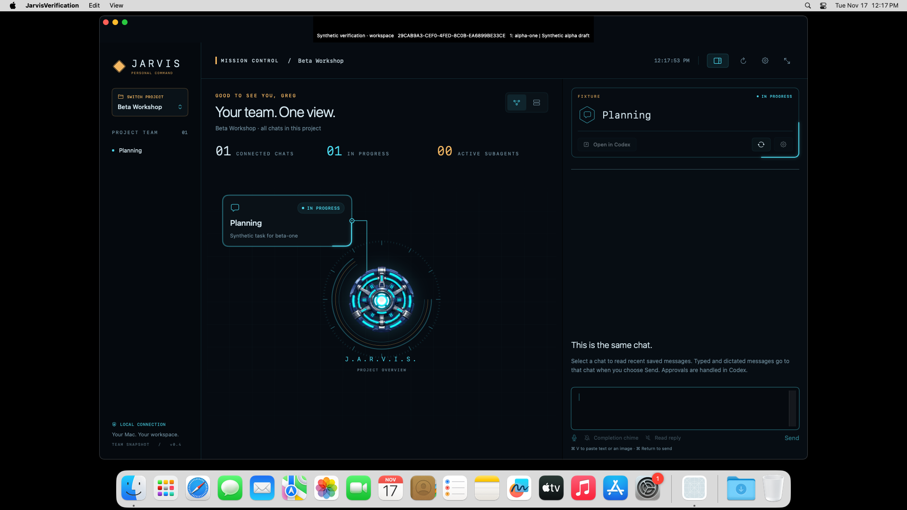
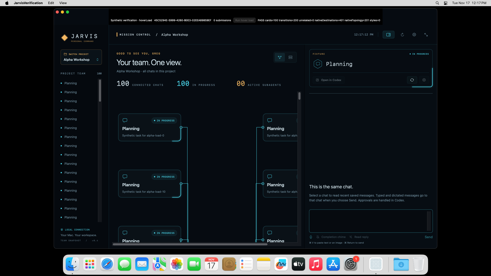
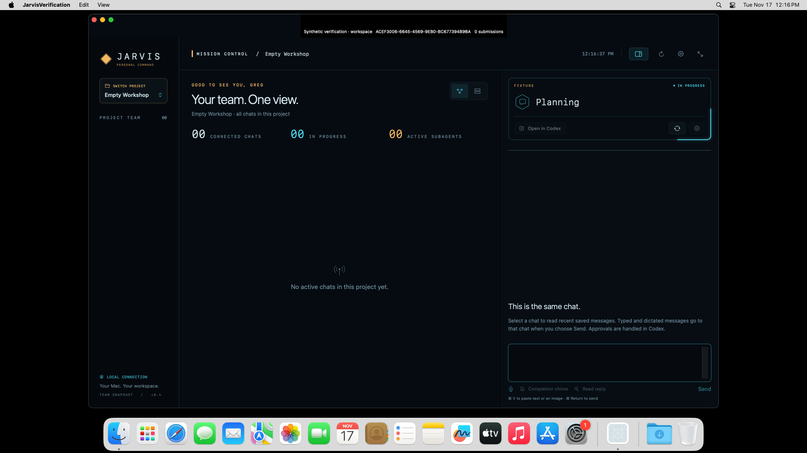

# Current Swift Jarvis: feature and visual behavior inventory

Date: 2026-11-17. Source baseline: `d61f5915a5bf85efe4272f1317c3c8f56ed49b9d`.
Purpose: the starting point for desktop rewrite parity under R20 in the [rewrite plan](cloud-harness-rewrite-plan.md). This describes the current implementation, not a redesigned product or a claim of full acceptance.

Evidence labels used below:

- **Source:** behavior found in current code; not freshly exercised in this inventory task.
- **Existing checks:** relevant test definitions/evidence already exist; tests were not rerun here.
- **Historical image:** retained synthetic native-UI screenshot, not a fresh current-build capture.
- **Pending:** needs a new synthetic capture, hands-on acceptance or an explicit rewrite mapping.

The inventory uses synthetic records. [Rewrite verification](rewrite-verification.md) records the baseline tests and their execution dates. The [owner verification checklist](https://github.com/ivangergo3/jarvis/issues/139) links the approved implementation issues.

## 1. Visual references and provenance

These images show fictional workspaces from retained native verification, inspected before inclusion. The visible verification banners, duplicate synthetic names, disabled integration buttons and empty message areas belong to the fixture. They are not intended product content. macOS menu/Dock areas are capture surroundings, not application layout.

### Project graph and conversation panel

Observe the three regions: fixed left navigation, central graph, right conversation panel. Cyan active borders/connectors contrast with gold section labels on a very dark blue background. The reactor stays in the central graph rather than being duplicated above the chat.

### Large graph

The 100-chat fixture demonstrates overflow/scrolling and repeated card geometry, not 100 real chats or a new CPU measurement. A static frame cannot establish animation smoothness, hover locality or response time.

### Empty project

Navigation and header remain present, counts fall to zero and an explicit empty-state message replaces the graph. The historical capture still shows the Planning header and composer in the conversation pane.

### Image record

Source: retained `NativeUI.xcresult` attachments from run `37701A80-60F0-4E58-8DA8-69E57186640D`, under the ignored `build/performance-47/evidence-47-54/ci-final-native/` directory. The three PNGs are copied unchanged into this document's asset directory.

| Document asset | Original attachment |
| --- | --- |
| `project-graph.png` | `BFC28084-2D97-47D4-8C60-77B79E2D9CF5.png` |
| `large-graph.png` | `6598AFC8-38BC-445E-A78F-797DB32A8D8E.png` |
| `empty-project.png` | `FBD87D67-BC8A-4C8C-B57B-64181487706C.png` |

That run records source `be9fed80cedaefc5c183422fd94bb72613d2d5cc`, Xcode 16.4 (16F6), macOS 15.7.9 (24G830), Release, executable SHA-256 `787d5a9cb3ce826c579627b9e058098ae04c898e43328d646e599daac0b14110`. The source object is unavailable in this local Git object store, so ancestry/equivalence to current HEAD was not established. Treat the images as historical composition references. Fresh same-build snapshots are needed before pixel-level rewrite comparisons.

Pending image coverage: populated all-project overview, card view, project chooser, both settings sheets, rich messages, image lightbox, recording/error/approval states, and full-screen/narrowest supported window. The native fixture intentionally disables some live capabilities; do not enable private integrations merely to fill screenshot gaps.

## 2. Visual identity and geometry

Source: [Theme.swift](../../Sources/Jarvis/Presentation/Components/Theme.swift), [Dashboard.swift](../../Sources/Jarvis/Presentation/Views/Dashboard.swift), [CompanionPanel.swift](../../Sources/Jarvis/Presentation/Views/CompanionPanel.swift).

| Element | Current implementation / parity baseline |
| --- | --- |
| Palette | Background RGB `(0.025, 0.045, 0.065)`; panel `(0.040, 0.070, 0.095)`; cyan `(0.29, 0.86, 0.94)`; gold `(0.96, 0.72, 0.39)`; text `(0.84, 0.91, 0.94)`; muted `(0.43, 0.55, 0.61)`. Values are normalized source colors, not screen samples. |
| Typography | Monospaced tracked uppercase labels, light large headings, regular readable body text. Chat body 13pt; primary dashboard heading 31pt; conversation title 21pt. Browser font/rendering equivalence needs visual acceptance rather than assuming pt equals CSS px. |
| Surfaces | Dark panels, thin translucent cyan strokes, modest rounded corners, restrained selected fills. No bright system-accent block on the active controls. |
| Dashboard | Minimum declared content size 1180 × 760; sidebar 215pt; top header 76pt. Main canvas minimum 500pt; resizable conversation minimum 340pt, ideal 440pt. |
| Reactor | Metallic/cyan artwork, orbit rings, centered glow; stationary position, no cursor tracking or bobbing. Ring motion and core-only opacity pulse use compositor layers. |
| Working state | Cyan in-progress badges, moving border treatment on working cards/header, animated connector signals when decorative motion is allowed. |
| Selection/hover | Selected outlines and destination/connector highlighting. Decorations do not intercept card clicks. Hover must not shift card layout or publish whole-workspace state. |
| Controls | Graph/card segmented icons, cogs, refresh and panel visibility controls share understated styling; full clickable areas include padding around glyphs. |
| Deliberately absent | No pause/play button in the header, duplicated Overview/Activity sidebar navigation, Task details/Conversation tabs, right-side status footer or duplicate large reactor above chat. Do not restore these from old screenshots. |

## 3. Navigation, graph and status features

All rows are source-backed inventory; the final column points to current check definitions or a remaining observation gap. IDs identify parity subjects, not newly created tickets.

| ID | User-visible behavior | Current support / evidence |
| --- | --- | --- |
| UI-01 | Left branding, project chooser and project/team navigation remain visible while the center/right content changes. Long project names wrap in the selector/sidebar. | Source; historical images. Project card titles themselves are limited to one line, unlike the selector. |
| UI-02 | Choose All projects or a project from a Jarvis-styled chooser; selected entry has a checkmark. Command-Shift-P opens it; Escape closes it. | Source; native keyboard journey. Fresh chooser screenshot pending. |
| UI-03 | Global graph nodes represent projects; a project graph represents its chats. Clicking a project drills into it; clicking a chat selects its conversation. | Source; native project/chat journey. A diagram does not imply an autonomous manager is running. |
| UI-04 | Sidebar chat ordering follows saved positions with deterministic fallback. Graph chat ordering is name then ID; do not assume every surface uses the same sort. | `ReaderTests.swift` saved-order/fallback cases; Dashboard graph sort. |
| UI-05 | Graph supports more than four chats, with horizontal/vertical overflow. Orthogonal connections lead to cards; signals have no arrowheads. | Layout source and `DomainTests.swift`; 100-card historical image/checks. |
| UI-06 | Graph/card mode controls change the central presentation. Card view has a reactor summary and two-column grid, vertical scrolling and an All projects action within a project. | Source; mode accessibility IDs. New captured card-view journey pending. |
| UI-07 | Cards show icon, title, task preview and status. The two-line preview filters out empty lines and lines starting with `https://` or `[https://`. When the filter removes every line, it falls back to the original text. | Source; verify representative long/wrapped content during parity capture. |
| UI-08 | Header shows scope and a live clock; counters show projects/chats, in-progress work and active subagents for the selected scope. | Source and historical images. Counts are observations, not evidence of successful task execution. |
| UI-09 | Status vocabulary: IN PROGRESS (cyan), STANDBY (muted), INTERRUPTED and UNKNOWN (gold). With a retained stale snapshot the conversation badge becomes UNKNOWN. Project card counts and chat card accessibility labels can still report the last known state. | Domain source, reader/status tests and stale native journey (conversation badge only). |
| UI-10 | Loading, no projects, empty project and unavailable source have distinct text. A refresh failure retains a usable prior snapshot/navigation while reporting the failure and unknown activity. | Fleet store tests; native empty/unavailable/stale journeys. |
| UI-11 | Refresh now updates workspace/history; Command-R works. Global cog opens a full styled settings sheet with interval choices 1/3/5/10/30 seconds, default 3. | Source; refresh preference tests. Settings sheet screenshot pending. |
| UI-12 | Polling backs off to at least 15 seconds when inactive/low-power and 30 when hidden, without speeding up a slower chosen interval. Unchanged data does not republish everything. | `AnimationEfficiencyTests.swift`, `FleetStoreTests.swift`; source. |

Source anchors: [Dashboard](../../Sources/Jarvis/Presentation/Views/Dashboard.swift), [DashboardPopups](../../Sources/Jarvis/Presentation/Views/DashboardPopups.swift), [RefreshInterval](../../Sources/Jarvis/Shared/RefreshInterval.swift), [Workspace](../../Sources/JarvisDomain/Workspace.swift), [graph layout](../../Sources/Jarvis/Shared/TeamGraphLayout.swift).

## 4. Conversation, input and files

| ID | User-visible behavior | Current support / evidence |
| --- | --- | --- |
| UI-13 | The top bar toggles one conversation panel and the divider resizes it. Hiding the panel cancels active dictation and stops current audio playback. | CompanionPanel disappearance handler; native/full-screen hands-on matrix pending. |
| UI-14 | Conversation header has role/icon/title/status, Open in Codex, reconnect and settings. Working header has a border signal. Operational phase text appears separately when relevant. | Source; historical graph image. Role label in this header still exists; distinguish it from the removed card role footer. |
| UI-15 | User messages align right with gold tint; Codex messages left with cyan tint. Both occupy at most 80% of panel width, capped at 760pt. Queued user messages are labelled. | CompanionPanel source. Populated-message screenshot pending. |
| UI-16 | Opening the panel anchors to the latest message. Current source also scrolls to bottom when the final message text changes. | Source; preserving a reader's scroll position is not established current behavior and must not be described as already implemented. |
| UI-17 | Paragraphs, headings, inline formatting, bullet/numbered lists, quotes, fenced code and tables render as formatted text. Code scrolls horizontally; tables have header/striped rows, column alignment and horizontal overflow. | Markdown/table tests; full rendered rich-message journey pending. No claim of arbitrary HTML or complete CommonMark support. |
| UI-18 | Attachment metadata is separated from message text; available local images render previews. Missing previews have a readable fallback; other local files can be revealed. | Attachment/model tests and source. No automatic remote-image downloads in the basic renderer. |
| UI-19 | Image click opens a large app-wide overlay without filename/Done chrome. Image fits within 90% of available dimensions. Escape or clicking outside the image closes it; clicking the image does not. | AttachmentTile source; fresh rendered lightbox/keyboard acceptance pending. |
| UI-20 | Composer has a cyan border and supports ordinary Mac editing, Command-V text/images and Command-Return send. Pasted images have removable pending previews. Image preparation is visible. | `ComposerImageTests.swift`; native draft keyboard journey. |
| UI-21 | Empty/oversized/unknown-destination or unsupported-history sends are blocked; limit notice at 16,000 characters. Busy/recording/unknown-outcome states restrict editing/actions. | CompanionModel/Panel and send tests. Capture all disabled-state labels in the parity walkthrough. |
| UI-22 | Selecting another chat does not send anything. Drafts remain associated with stable IDs, including identically named chats. A retained pinned scope shows a mismatch warning; reconnect/discard is explicit. | Linked conversation and regression tests; native draft destination journey. Switching while busy/recording/importing can deliberately defer following. |
| UI-23 | Queued delivery, failure and uncertain outcome remain distinguishable. Unknown delivery warns against automatic resend. History reconciliation deduplicates by receipt/client IDs, not identical text. | Linked conversation/regression tests. Do not turn lost acknowledgement into a second task. |

Source anchors: [CompanionPanel](../../Sources/Jarvis/Presentation/Views/CompanionPanel.swift), [CompanionModel](../../Sources/Jarvis/Application/CompanionModel.swift), [LinkedConversation](../../Sources/Jarvis/Application/LinkedConversation.swift), [ChatMarkdownView](../../Sources/Jarvis/Presentation/Components/ChatMarkdownView.swift), [MarkdownTableView](../../Sources/Jarvis/Presentation/Components/MarkdownTableView.swift), [AttachmentTile/lightbox](../../Sources/Jarvis/Presentation/Components/AttachmentTile.swift), [ComposerEditor](../../Sources/Jarvis/Presentation/Platform/ComposerEditor.swift).

## 5. Connection, approvals, audio and settings

| ID | User-visible behavior | Current support / evidence |
| --- | --- | --- |
| UI-24 | Current normal UI reads saved desktop workspace/history and sends to the selected existing Codex chat through shared queue operations. Open in Codex targets its ID. | Current linked integration and historical requirements. This is intentionally replaced by new CLI sessions, not silently retained as a rewrite dependency. |
| UI-25 | Chat cog opens Connection & voice: executable selection, dictation language, local-audio explanation, subagents and last activity. Changes to executable apply on reconnect. | Source; fixture disables external actions/settings. Fresh safe settings capture pending. |
| UI-26 | Dictation records locally when supported, shows authorization/listening/finishing/cancel state and produces an editable draft. It does not send the transcript automatically or use a cloud fallback. Languages: UK/US English, French, Hungarian. | LocalVoice/dictation tests and source. Real permission, recognition and microphone acceptance not established here. |
| UI-27 | Completion chime and Read reply are independently selectable. Both on means chime first, then macOS speech. Old refreshed history should not produce fresh completion alerts. | LocalVoice and linked-history tests; audible quality pending. This is not live full-duplex voice. |
| UI-28 | Recorded subagents and last activity are in chat settings; missing agents show an explicit empty message. Stale source changes agent status to unknown. | Source. This observes recorded agents, not a working autonomous hierarchy. |
| UI-29 | Approval/question widgets exist for a Jarvis-owned runtime: supplied choices, command/file/network detail, question answers and controlled response state. | Source and runtime fixtures. **Existing linked desktop approvals are handled in Codex**, not generically controllable from Jarvis. The rewrite will own its CLI runtime and must explicitly qualify this mapping. |

Source anchors: [LocalVoice](../../Sources/Jarvis/Integrations/LocalVoice.swift), [CompanionPanel](../../Sources/Jarvis/Presentation/Views/CompanionPanel.swift), [CodexConnection](../../Sources/Jarvis/Integrations/CodexConnection.swift), [DesktopActions](../../Sources/Jarvis/Integrations/DesktopActions.swift), [existing integration limits](../../REQUIREMENTS.md).

## 6. Windowing, motion and performance behavior

| ID | Current implementation | Rewrite significance / evidence |
| --- | --- | --- |
| UI-30 | Top-bar full-screen action and Control-Command-F target the main window and disable during transition. Window geometry is autosaved. Standard Edit commands/menu are installed. | Source; display/Spaces, full-screen transitions and focus need hands-on acceptance. Do not claim support based only on screenshots. |
| UI-31 | **Closing the last Swift window requests app termination.** Shutdown cancels dictation/audio and awaits companion shutdown. | Main.swift source. This differs from the agreed future close-window behavior; it is not a parity bug to change it intentionally. |
| UI-32 | Reactor artwork stays fixed; orbit rings and a confined white-core opacity pulse animate through retained layers. Reduce Motion/visibility/power affect decoration execution. | Animation layer/ownership tests. Static images do not prove perceived pulse brightness/smoothness. |
| UI-33 | Mouse tracking/bobbing is absent. Card hover updates retained destination/connector decorations rather than dashboard/conversation state or geometry. | Deterministic hover, native 100-card and physical-pointer journeys. Keep this explicit to avoid the original freeze/high-CPU regression. |
| UI-34 | Existing native warning budgets: idle CPU ≤5%, continuous hover ≤12% at 20 chats / ≤20% at 100, on the recorded Mac; 100% means one logical core. | Historical scoped warnings, not new measurements, universal gates or accepted Electron budgets. Rebaseline the packaged rewrite before enforcing new numeric limits. |

Sources: [Main](../../Sources/Jarvis/Main.swift), [WindowControls](../../Sources/Jarvis/Presentation/Platform/WindowControls.swift), [HUDAnimations](../../Sources/Jarvis/Presentation/Platform/HUDAnimations.swift), [GraphHover](../../Sources/Jarvis/Presentation/Components/GraphHover.swift), [baseline protocol](https://github.com/ivangergo3/jarvis/blob/d61f5915a5bf85efe4272f1317c3c8f56ed49b9d/docs/engineering/performance-47.md), [measured performance results](../../evaluations/performance-v3-2026-11-17/REPORT.md).

## 7. Existing checks and honest coverage limits

The current [native UI journeys](native-ui.md) include project/chat selection, empty project/workspace, unavailable/stale data, keyboard/draft routing, synthetic 100-card hover and real-pointer load. See [UITests](../../UITests/JarvisUITests.swift). They are not a complete feature-parity suite and were not rerun for this document.

Relevant existing Swift test groups include [reader/navigation](../../Tests/JarvisTests/ReaderTests.swift), [refresh state](../../Tests/JarvisTests/FleetStoreTests.swift), [Markdown](../../Tests/JarvisTests/ChatMarkdownTests.swift), [tables](../../Tests/JarvisTests/MarkdownTableTests.swift), [images/paste](../../Tests/JarvisTests/ComposerImageTests.swift), [linked routing](../../Tests/JarvisTests/LinkedConversationTests.swift), [regressions](../../Tests/JarvisTests/RegressionTests.swift) and [animation/hover](../../Tests/JarvisTests/AnimationEfficiencyTests.swift).

Some source views remain defined but are not exposed by the current navigation: `activityView` and `globalBrief` do not establish active Activity/Task details features. Keep source presence distinct from reachable UI. Current preferences persist selected project/chat and refresh interval; do not assume every layout/audio option or draft survives app termination without verifying its storage path.

Pending qualification includes rich rendered conversations/attachments, settings and mode-switch screenshots, current-build full-screen/window matrices, real audio, accessibility/focus, missing files, disconnect/recovery and actual CLI-owned approval behavior. Capture these outcomes in the corresponding implementation and parity issues.

## 8. Explicit rewrite mappings and lifecycle discussion

These are agreed future changes, **not observations of today's Swift app**:

| Area | Current Swift baseline | Agreed rewrite direction |
| --- | --- | --- |
| Runtime/history | Linked saved Codex desktop chats and shared queue | Local NestJS + controlled Codex CLI, subscription sign-in, new Jarvis sessions. Import old histories later. |
| Storage/login | Existing desktop records plus local app preferences | Local Docker-based Supabase and Supabase Auth; define migration only for accepted new-app data. |
| Close window | Last window terminates the Swift app | Latest decision: confirm before stopping the service and active tasks. Cancel leaves work intact; supersedes keep-running-on-close. |
| Command-Q | Swift termination cleanup; no general keep-running service contract | Confirm before stopping the service and active tasks. Canceling the confirmation leaves work intact. |
| Service start | Swift follows the selected chat. With no chat selected it does not connect. The Codex child starts on the connection’s first request. | Start the local Nest service when Jarvis opens. No automatic login service. |
| Approvals | Linked desktop runtime owns its approvals | New CLI-owned runtime needs correctly correlated approval UI and permission enforcement. |
| Visuals | Current cyan/gold reactor dashboard | Preserve appearance/interaction; no redesign mixed into the port. |

The local lifecycle specification must name the service owner, prevent duplicate service/CLI owners, define confirmed shutdown/relaunch, and handle crashes, database unavailability and machine sleep truthfully. An app window, backend and running Codex processes have separate lifetimes even when a confirmed close shuts them down together. After failure, restore durable state, reconcile actual outcomes and never blindly replay uncertain commands.

The owner subsequently selected confirmation for both window close and Command-Q, launch-on-open and reconciliation-based crash recovery. Exact shutdown timeout/escalation, supervision mechanism and initial concurrency still need design. These rewrite lifecycle changes are documented, not implemented in the Swift app. No login item/service has been installed.

## 9. How to use this inventory next

Walk through UI-01–UI-34 against synthetic current-build screens, resolve gaps and explicitly accept any integration mappings. Match the Electron implementation to that baseline using the same representative data, window geometry and motion settings. Record justified platform/font differences; do not use historical images as pixel-exact current-build proofs.

Follow the approved GitHub issues in dependency order. The owner checks the items in the [phase-one verification checklist](https://github.com/ivangergo3/jarvis/issues/139) after trying the delivered behavior.
